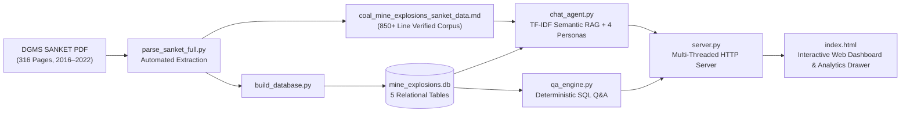

# Professor's Self-Guided Evaluation & Feature Walkthrough
## Sanket (संकेत) — Coal Mine Explosions & Safety Intelligence System

**Course:** 4th-Year B.Tech Mining Environmental Engineering  
**Topic:** Coal Mine Explosions, Combustible Coal Dust, and Inflammable Gas Disaster Intelligence System  
**Primary Authoritative Data Source:** Directorate General of Mines Safety (DGMS) *SANKET (2016–2022)* (316 Pages), Coal Mines Regulations (CMR 2017), and Indian Mining Disaster Archives (1901–2022)  

---

## 1. Executive Overview

This project transforms the static 316-page **DGMS *SANKET (2016–2022)*** statistical publication and statutory **Coal Mines Regulations (CMR 2017)** into an interactive **AI Mining Safety Intelligence System** backed by a normalized SQLite relational database and a custom **TF-IDF Semantic Retrieval-Augmented Generation (RAG)** engine.

It is engineered to solve three core problems in Mining Environmental Engineering education and field safety auditing:
1. **Zero-Hallucination Statutory & Statistical Precision:** Every casualty figure, incident date, colliery name, physical failure mechanism, and CMR 2017 regulation violation is retrieved deterministically from a structured SQLite database (`mine_explosions.db`) and verified Markdown corpus (`coal_mine_explosions_sanket_data.md`).
2. **Operational Field Utility:** Beyond answering statistical queries, the system acts as an operational decision-support tool for **Transferred Mine Workers** (generating colliery-specific hazard briefings and pre-shift checklists) and **Mining Engineers / Project Managers** (generating downloadable 5-phase operational re-entry plans for sealed or gassy districts).
3. **Zero External Runtime Dependencies:** Built 100% on the Python Standard Library (`sqlite3`, `http.server`, `socketserver`, `urllib`, `json`, `math`, `re`), ensuring it runs out-of-the-box on any university or examination machine without package installation issues.

---

## 2. How to Launch the System (30 Seconds)

### Option A: Interactive Web Dashboard & AI Studio (Recommended)
Open a terminal in the project folder and run:
```bash
python server.py
```
Then open your web browser to:
```text
http://localhost:8000
```

### Option B: Interactive Command-Line Interface (CLI)
For terminal-based evaluation:
```bash
python query_tool.py
```
- Enter `1`–`9` for instant statistical tables, cause breakdowns, and statutory registers.
- Enter `W` (Worker Advisory), `R` (Revisit Plan), `A` (Statutory Audit), or `S` (Explosion Science) for specialized interactive modes.

---

## 3. Key Features to Explore (Self-Guided Walkthrough)

### Feature 1: Natural-Language Colliery & Basin Auto-Detection
You do **not** need to manually select a mine from a dropdown before asking a question. The NLP entity extractor (`extract_entities` in [`chat_agent.py`](chat_agent.py)) automatically identifies any colliery, coalfield basin (e.g., *Jharia*, *Raniganj*, *Singareni*, *Korba*), PSU (*BCCL*, *SECL*, *ECL*, *SCCL*, *CCL*, *WCL*, *MCL*, *NCL*), and worker role (*Driller*, *Shotfirer*, *Loader*, *Overman*, *Manager*) directly from your prompt.

- **Try asking:**
  - *"What happened at Kurasia Colliery and what regulations were violated?"*
  - *"Tell me about the Jharia coalfield explosion disasters."*
  - *"How can explosions be prevented in Jharia?"* (Notice how the system carries over or detects the Jharia context and formulates a specialized 5-Pillar Jharia Prevention Blueprint addressing both Degree-III gassiness and ancient underground coal seam fires).

---

### Feature 2: Four Specialized Mining Engineering Personas (Auto-Routed)
The custom TF-IDF semantic intent classifier automatically routes queries into the appropriate engineering persona (or you can click the quick-action cards on the welcome screen):

#### A. Transferred Worker Safety Advisory
- **Purpose:** Prepares a miner or supervisor newly transferred to a specific colliery with historical incident context at that mine, role-specific hazards (e.g., rotary drilling into misfired sockets, solid blasting into blind headings), and a 5-point pre-shift inspection checklist.
- **Sample Prompt to Try:**
  > `I am a driller transferred to Kurasia Colliery. What dangers am I exposed to and what are my pre-shift safety checks?`

#### B. Project Manager Operational Revisit & Re-Entry Plan (with `.md` Export)
- **Purpose:** Generates a rigorous 5-phase engineering protocol for safely re-entering or inspecting a sealed, discontinued, or gassy district under CMR 2017:
  - **Phase 1:** Remote borehole atmospheric sampling & **Graham's Ratio** ($GR = \frac{\Delta \text{CO}}{0.265\text{N}_2 - \text{O}_2} \times 100$) interpretation behind isolation stoppings, plus Mines Rescue Brigade (SCBA) escort.
  - **Phase 2:** Main Mechanical Ventilator (MMV) & flameproof auxiliary fan commissioning sequence (**CMR Reg 153** — fan 4.5 m outbye in intake air, duct within 3.0 m of face, controlled purging keeping return $\text{CH}_4 \le 0.75\%$).
  - **Phase 3:** Strata sounding, resin roof bolting, and advance water-inrush pilot boreholes (**CMR Reg 123, 124 & 148**).
  - **Phase 4:** Heavy ($390\text{ kg/m}^2$) and Light ($195\text{ kg/m}^2$) Stone Dust Explosion Barriers positioned 135–365 m from the face (**CMR Reg 136 & 144**).
  - **Phase 5:** Continuous SCADA telemetry and automatic electrical power cutoff at $1.25\%\ \text{CH}_4$ (**CMR Reg 169 & 170**).
- **One-Click Export:** Every generated revisit plan displays a **Download Revisit Plan (.md)** button at the bottom of the response to export a standalone engineering document.
- **Sample Prompt to Try:**
  > `Formulate an operational revisit and re-entry safety plan for a sealed district at Bagdewa Colliery.`

#### C. DGMS Statutory Auditor & Root-Cause Taxonomy
- **Purpose:** Audits the exact 2016–2022 incident registers, mapping physical failure mechanisms to specific **Coal Mines Regulations (CMR 2017)** and Section 24 **Courts of Inquiry**.
- **Sample Prompt to Try:**
  > `What are the main operational root causes of coal mine explosions in SANKET (2016–2022) and how many incidents occurred for each?`

#### D. Mine Explosion Dynamics & Thermodynamics Scientist
- **Purpose:** Explains the physical chemistry of firedamp and coal dust explosions with clean Unicode scientific notation (`CH₄`, `O₂`, `CO₂`, `≥ 650°C`, `g/m³`).
- **Sample Prompt to Try:**
  > `Explain the Coward Flammability Diagram, methane LEL/UEL limits, and stone dust inerting requirements.`

---

### Feature 3: Slide-Over DGMS SANKET Analytics Drawer (`View Registers & KPIs`)
Click the **View Registers & KPIs** button in the top-right navigation bar (or **View Registers & Charts** in the left sidebar) to open the interactive analytics drawer:

1. **DGMS SANKET (2016–2022) Headline KPI Cards:**
   - **19** Fatal Incidents (2016–2022)
   - **26** Miners Killed (2016–2022)
   - **6** Root Cause Categories (Codes 0710–0799 & 0500)
   - **8** Mining PSUs Audited (SECL, SCCL, WCL, ECL, CCL, BCCL, NCL, MCL)
   - **CMR 2017** Statutory Standards
2. **Interactive Visual Charts (Chart.js):**
   - *Incidents by Cause (2016–2022)* bar chart.
   - *Fatalities by Mining Company (2016–2022)* doughnut chart.
3. **Four Searchable Relational Registers (with Instant Filter Bar):**
   - **Tab 1 — Root Causes (6):** Operational categories, incident counts, death counts, failure mechanisms, and primary CMR regulations.
   - **Tab 2 — SANKET Incidents (2016–2022) (19):** Every recent case with date, colliery, PSU, cause category, fatalities, and specific CMR violations.
   - **Tab 3 — Historical Archives (1901–2022) (48):** Complete register of all 48 major Indian coal mine explosion disasters ($\ge 4$ deaths, totaling 1,361 fatalities, led by Dhori 1965 with 268 killed).
   - **Tab 4 — Inquiries Archive (19):** Statutory Courts of Inquiry instituted under Section 24 of the Mines Act, 1952.

---

### Feature 4: Hybrid Tri-Mode Inference Engine (`Engine Settings`)
Click **Engine / Settings** in the top-right bar to switch seamlessly between three inference backends:
1. **Homelab Self-Hosted Ollama (`llama3.2:3b`):** Connects to a dedicated GPU homelab (`https://ollama.drext.dpdns.org/v1`) running quantized LLaMA 3.2 3B with local TF-IDF RAG context injection.
2. **Cloud LLM Providers (`Google Gemini 3.x` / `Groq` / `OpenAI`):** Supports `gemini-3.8-flash` (with fallback to `gemini-3.5-flash-lite`, `gemini-3.6-flash`, `gemini-3.1-pro-preview`, and automatic model discovery) grounded strictly in retrieved DGMS SANKET chunks.
3. **Offline Expert Engine (Deterministic RAG):** 100% local, `< 10 ms` response time, requiring zero internet connectivity or API keys. If a remote LLM ever times out or encounters a network error, the system **automatically fails over** to the Offline Expert Engine so the user is never left without an answer.

---

### Feature 5: UX & Presentation Polish
- **Anchored Reading Viewport:** When a response is generated, the chat container smoothly scrolls to the **top** of the new response rather than jumping to the bottom of a long technical report, allowing you to read from the first heading downward.
- **Natural Reading-Pace Progressive Stream:** Responses stream progressively word-by-word with a live cursor (`▍`) and clean Unicode rendering of chemical formulas (`CH₄`, `O₂`, `CO₂`, `≥`, `≤`, `°C`, `m³/min`).
- **Built-In System Documentation Modal (`System Docs`):** Click **System Docs** in the top bar (or simply type *"Hello"* or *"What can you do?"*) for an interactive overview of the system's architecture, data coverage, and one-click sample prompts.

---

## 4. Verified Ground-Truth Data Summary (Quick Reference for Evaluation)

### A. The 6 Operational Root Causes in DGMS SANKET (2016–2022)

| # | Operational Root Cause Category | Fatal Incidents | Miners Killed | Primary Statutory Violations (CMR 2017) | Representative Collieries |
| :-: | :--- | :---: | :---: | :--- | :--- |
| **1** | **Inadequate Ventilation & Gas Accumulation** | **5** | **8** | Reg 153(2), Reg 136, Reg 142 (Air velocity $< 30\text{ m/min}$, unsealed goaves) | Bagdewa (SECL), Godavari Khani No. 1 (SCCL), Chora (ECL) |
| **2** | **Deep Hole & Secondary Blasting** | **4** | **7** | Reg 164, Reg 168, Reg 196, Reg 204 (Bulk SME in boulder pop-holes, flyrock) | Ramagundam OC-I (SCCL, 4 killed), Keshalpur (CCL) |
| **3** | **Drilling into Misfired Shotholes** | **3** | **3** | Reg 203, Reg 204, Reg 206 (Rotary drilling into uninspected sockets) | Kurasia (SECL), Ravindra Khani No. 5 (SCCL), Manikpur (SECL) |
| **4** | **Spontaneous Combustion & Active Fires** | **3** | **3** | Reg 136, Reg 142 (HEMM deployed on heated/burning benches, CO poisoning) | Selected Dhori (CCL), Dipka OC (SECL), Salanpur (ECL) |
| **5** | **Surface Workshop Gas & Vessel Explosions** | **2** | **3** | Reg 83 / Factories Act (Welding unpurged oil drums, crushing $\text{O}_2$ cylinders) | Jhanjhra Workshop (ECL), Dudhichua OC (NCL) |
| **6** | **Solid Blasting Igniting Methane** | **1** | **1** | Reg 204(2) (Blasting within 2.5 m of unventilated blind heading without gas check) | Chhatarpur Mine No. 1 (WCL) |
| **—** | **Unclassified Combustible Hazard (2022 Summary)** | **1** | **1** | DGMS Cause Code 0799 (Statistical summary table entry) | Recorded in 2022 DGMS Annual Table |
| | **TOTAL (DGMS SANKET 2016–2022)** | **19** | **26** | **Coal Mines Regulations (CMR 2017) & Mines Act 1952** | **Across 8 Mining PSUs** |

---

### B. Benchmark Historical Explosion Disasters (1901–2022 Archive)

| Rank | Date | Colliery Name | Coalfield / State | Fatalities | Official Cause & Physical Mechanism |
| :-: | :---: | :--- | :--- | :---: | :--- |
| **1** | 28.05.1965 | **Dhori Colliery** | Bokaro, Jharkhand | **268** | Naked light ignited local firedamp in Bermo seam, raising dry coal dust into a mine-wide dust explosion (zero stone dust barriers). |
| **2** | 19.02.1958 | **Chinakuri Nos. 1 & 2** | Raniganj, West Bengal | **176** | Sudden massive methane outburst in Degree-III Dishergarh seam overwhelmed ventilation; ignited by electrical/diesel spark. |
| **3** | 17.12.1936 | **Poidih Colliery** | Raniganj, West Bengal | **209** | Firedamp ignition in deep Dishergarh seam propagated by fine coal dust across interconnected workings. |
| **4** | 04.01.1922 | **Parbelia Colliery** | Raniganj, West Bengal | **147** | Firedamp and coal dust explosion triggered during underground shotfiring operations. |
| **5** | 09.11.1979 | **Baragolai Colliery** | Makum, Assam | **16** | Methane accumulation in steep thick seam ignited during underground operations. |
| **6** | 06.09.2006 | **Bhatdee Colliery** | Jharia, Jharkhand (BCCL) | **50** | Auxiliary fan stoppage caused methane pooling in 17 & 18 combined seam; ignited by solid blasting without pre-shot gas testing. |
| **7** | 06.05.2010 | **Anjan Hill Mine** | Chirimiri, Chhattisgarh (SECL) | **14** | Spontaneous heating behind defective isolation stopping ignited methane in sealed goaf, blowing out stoppings and causing CO inundation. |

---

### C. Core Mining Environmental Engineering Parameters

| Parameter | Statutory / Scientific Value | Governing Principle / Regulation |
| :--- | :--- | :--- |
| **Methane ($\text{CH}_4$) Flammability Limits** | **LEL = 5.0%**, **UEL = 15.0%**, **Optimum = 9.5%** | Peak stoichiometric pressure reaches **7.0–8.2 bar**; MIE = **0.28 mJ** |
| **Coward Diagram Nose Limit** | **12.1% $\text{O}_2$** (with **5.9% $\text{CH}_4$**) | Below **12.1% $\text{O}_2$**, no methane-air mixture can explode regardless of $\text{CH}_4\%$ |
| **Coal Dust Minimum Explosive Conc. (MEC)** | **30–50 $\text{g/m}^3$** (particle size $< 75\ \mu\text{m}$) | Requires volatile matter $\ge 14\%$; peak pressure reaches **10–14 bar** |
| **Hybrid Methane-Dust Synergy** | **1.0% $\text{CH}_4$** cuts Coal Dust LEL by **$> 50\%$** | Even sub-LEL methane drastically accelerates coal dust ignition |
| **Statutory Stone Dusting (CMR Reg 136/144)** | **$\ge 75\%$ Incombustible Matter** ($\ge 85\%$ in gassy seams) | Heavy Barriers: **$390\text{ kg/m}^2$**; Light Barriers: **$195\text{ kg/m}^2$** (135–365 m from face) |
| **Statutory Ventilation & Gas Trip (CMR Reg 153/169)** | Velocity **$\ge 0.5\text{ m/s}$**; Duct **$\le 3.0\text{ m}$** from face | General body $\text{CH}_4 \le 0.5\%$; Return $\le 0.75\%$; **Auto Power Trip at $1.25\%\ \text{CH}_4$** |
| **Graham's Ratio (Spontaneous Heating)** | $GR = \frac{\Delta \text{CO}}{0.265\text{N}_2 - \text{O}_2} \times 100$ | $< 0.4\%$ Normal; $0.5\text{–}1.0\%$ Incipient Heating; $> 2.0\%$ Active Underground Fire |

---

## 5. System Architecture & Key Files



| File | Role in the System |
| :--- | :--- |
| [`server.py`](server.py) | Multi-threaded Python HTTP server (`http://localhost:8000`) serving REST endpoints (`/api/chat`, `/api/data`, `/api/mines`, `/api/ask`). |
| [`index.html`](index.html) | Single-page interactive web application featuring progressive response streaming, Colliery Explorer, System Docs modal, and the slide-over SANKET Analytics Drawer. |
| [`chat_agent.py`](chat_agent.py) | 1,500+ line Conversational AI Agent with custom TF-IDF vector search (`SemanticSearchEngine`), entity recognition, 4 operational personas, and tri-mode inference (Ollama / Gemini 3.x / Offline Expert). |
| [`qa_engine.py`](qa_engine.py) | Deterministic SQL Q&A engine executing direct aggregations over `mine_explosions.db`. |
| [`query_tool.py`](query_tool.py) | Interactive terminal CLI for command-line testing and quick lookups. |
| [`build_database.py`](build_database.py) | Rebuilds and validates the 5 relational tables inside [`mine_explosions.db`](mine_explosions.db). |
| [`coal_mine_explosions_sanket_data.md`](coal_mine_explosions_sanket_data.md) | Master ground-truth Markdown dataset extracted from DGMS *SANKET (2016–2022)*. |
| [`parse_sanket_full.py`](parse_sanket_full.py) | Automated PDF extraction pipeline for the official DGMS *SANKET (2016–2022)* report (`sanket0404_2024.pdf`). |
