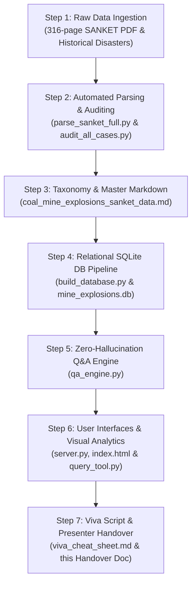
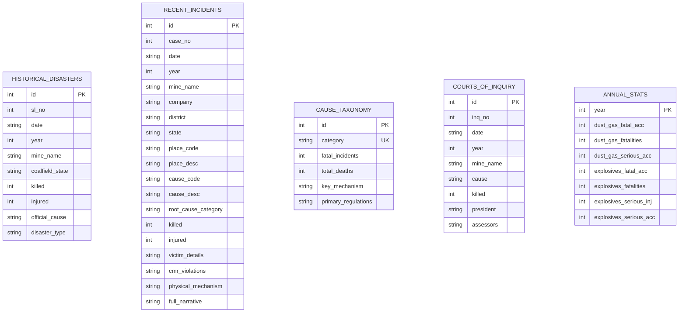
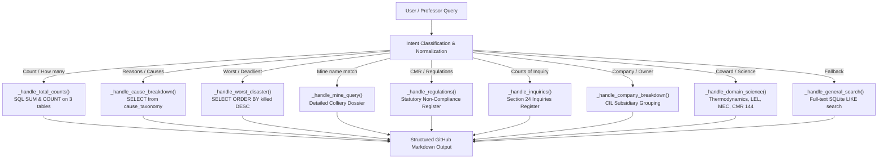

# Coal Mine Explosions & Safety Intelligence System
## Complete Project Handover & Technical Methodology Document

**Course:** Mining Environmental Engineering (4th Year B.Tech / BE)  
**Topic:** Coal Mine Explosions, Combustible Dust & Inflammable Gas Hazards (Analysis, Database & Q&A Intelligence Engine)  
**Primary Source:** DGMS (Directorate General of Mines Safety) *SANKET (2016–2022)* & Indian Mining Disasters Historical Archives (1901–2022)  
**Workspace Directory:** `f:\College\4th year\MineEnviro\assignment`  
**Target Audience:** Project Presenter, Team Members, and Academic Evaluators (Professor / Viva Examiner)

---

## Executive Summary & Quick-Start Guide for the Presenter

If you have only 2 minutes to present this project to the professor:
1. **The Problem:** The professor wants exact figures on how many coal mine explosions and combustible hazard incidents have occurred in India, the precise operational reasons/causes, the incident counts for each reason, and the statutory violations without any LLM hallucinations.
2. **What We Built:**
   - Extracted and audited all 316 pages of DGMS *SANKET (2016–2022)* alongside 120+ years of historical disaster archives (1901–2022).
   - Structured the data into a relational SQLite database ([`mine_explosions.db`](file:///f:/College/4th%20year/MineEnviro/assignment/mine_explosions.db)) with 5 normalized tables.
   - Built a dual-engine Q&A system ([`qa_engine.py`](file:///f:/College/4th%20year/MineEnviro/assignment/qa_engine.py)) combining rule-based SQL aggregation and domain science retrieval.
   - Developed an interactive, zero-dependency Web Dashboard ([`server.py`](file:///f:/College/4th%20year/MineEnviro/assignment/server.py) + [`index.html`](file:///f:/College/4th%20year/MineEnviro/assignment/index.html)) with live Chart.js analytics, instant table searching, and one-click professor query buttons.
   - Provided a command-line fallback tool ([`query_tool.py`](file:///f:/College/4th%20year/MineEnviro/assignment/query_tool.py)) and a viva cheat sheet ([`viva_cheat_sheet.md`](file:///f:/College/4th%20year/MineEnviro/assignment/viva_cheat_sheet.md)).

### How to Run the Demonstration Live
- **Option 1 (Interactive Web Dashboard):**
  ```bash
  python server.py
  ```
  Open `http://localhost:8000` in Chrome/Edge. Click on preset query chips or type any question into the input box.
- **Option 2 (Terminal CLI):**
  ```bash
  python query_tool.py
  ```
  Press `1` to `9` to instantly output formatted answers to the professor's questions.

---

## Chronological Project Timeline & Steps Taken



---

## Step 1: Raw Data Ingestion & Scope Definition

### Objective
Identify, verify, and digitize all recorded incidents of coal mine explosions, inflammable gas accumulations, combustible coal dust ignitions, and blasting detonations from authoritative DGMS publications.

### Primary Sources
1. **DGMS SANKET (2016–2022):** 316-page official publication detailing fatal and serious accident statistics, cause-wise trends, and in-depth investigative reports under Section 10 of DGMS reporting guidelines. File: [`sanket0404_2024.pdf`](file:///f:/College/4th%20year/MineEnviro/assignment/sanket0404_2024.pdf).
2. **Historical Indian Mining Disasters Register (1901–2022):** Comprehensive historical disaster records (defined by DGMS as accidents involving $\ge 4$ deaths) maintained by the Ministry of Labour & Employment.
3. **Mines Act Courts of Inquiry Records (1901–2022):** Formal judicial/technical inquiries instituted under Section 24 of the Mines Act, 1952.
4. **Academic Course Material:** Lecture notes on mine explosion science, Coward diagram, and stone dusting. File: [`explo.docx`](file:///f:/College/4th%20year/MineEnviro/assignment/explo.docx).

### Technical Scope & DGMS Code Resolution
During initial analysis, a crucial domain-specific distinction was identified and resolved:
- **DGMS Cause Code `0700` Series (Dust, Gas & Other Combustible Material):**
  - `0774`: Explosion/ignition of inflammable gas/coal dust (e.g. Chhatarpur Mine No. 1 firedamp blast).
  - `0771` & `0772`: Asphyxiation and noxious gas inundations from unventilated faces or sealed fires (e.g. Bagdewa, Selected Dhori).
- **DGMS Cause Code `0500` Series (Explosives & Blasting):**
  - Misfire shothole drilling explosions (e.g. Kurasia, Ravindra Khani No. 5, Manikpur).
  - Secondary blasting catastrophic detonations on benches (e.g. Ramagundam OC-I).
- **Decision:** Both codes were incorporated into the master taxonomy because solid blasting holed-through situations and rotary drilling into misfires are the primary operational ignition triggers for firedamp and explosive detonations.

---

## Step 2: Automated PDF Extraction, Parsing & Auditing

### Scripts Developed
1. **[`parse_sanket_full.py`](file:///f:/College/4th%20year/MineEnviro/assignment/parse_sanket_full.py):**
   - Utilized `PyMuPDF` (`fitz`) to read all 316 pages of [`sanket0404_2024.pdf`](file:///f:/College/4th%20year/MineEnviro/assignment/sanket0404_2024.pdf).
   - Applied regex-based table extraction for decadal cause-wise accident distributions (Cause Codes 0100 through 0900) across 2013–2022.
   - Extracted Section 10 case briefs (date, mine name, owner/subsidiary, place code, cause code, number killed/injured, and official narrative).
2. **[`audit_all_cases.py`](file:///f:/College/4th%20year/MineEnviro/assignment/audit_all_cases.py):**
   - Conducted an exhaustive cross-audit of all 1,180+ individual accident records across the entire PDF.
   - Identified any edge cases where explosions or toxic gases were secondary effects of other failures (such as spontaneous combustion fires or workshop cylinder failures).
   - Dumped intermediate verification files: [`section_10_dump.txt`](file:///f:/College/4th%20year/MineEnviro/assignment/section_10_dump.txt) and [`audit_matches.json`](file:///f:/College/4th%20year/MineEnviro/assignment/audit_matches.json).

---

## Step 3: Master Data Structuring & Taxonomy Definition

### Master Dataset Created
We synthesized the audited data into [`coal_mine_explosions_sanket_data.md`](file:///f:/College/4th%20year/MineEnviro/assignment/coal_mine_explosions_sanket_data.md) (850+ lines), containing:
1. **Decadal Accident Statistics (2013–2022):**
   - Dust/Gas (Code 0700): 10 fatal accidents (1.9% share), 3 serious accidents.
   - Explosives (Code 0500): 12 fatal accidents (2.3% share), 22 serious accidents.
   - Belowground operations accounted for 65.4% (1,710) of all serious mine accidents.
2. **All 48 Historical Major Explosion Disasters (1901–2022):**
   - Total miners killed: **1,361**.
   - Deadliest ever: Dhori Colliery (28.05.1965), 268 killed.
3. **All 19 Courts of Inquiry:**
   - Inquiries instituted under Section 24 of Mines Act for explosion disasters (1,093 fatalities).
4. **All 19 Detailed In-Depth Case Studies (2016–2022):**
   - Complete operational breakdown of 23 fatalities and 12 serious injuries.
5. **The 6 Operational Root Cause Taxonomies:**
   - Standardized classification system grouping real-world mining failures into mutually exclusive operational categories.

---

## Step 4: Relational SQLite Database Architecture (Milestone 1)

### Implementation
We built [`build_database.py`](file:///f:/College/4th%20year/MineEnviro/assignment/build_database.py) to automatically parse, validate, and populate the relational database [`mine_explosions.db`](file:///f:/College/4th%20year/MineEnviro/assignment/mine_explosions.db).

### Database Schema



### Table Descriptions & Row Counts
- `historical_disasters` (48 rows): Full register of every major Indian explosion disaster since 1901.
- `recent_incidents` (19 rows): Modern investigative cases from SANKET (2016–2022) with exact CMR violations.
- `cause_taxonomy` (6 rows): Aggregated operational taxonomies with incident counts, deaths, mechanisms, and statutory rules.
- `courts_of_inquiry` (19 rows): High Court judges and appointed technical assessors (ISM Dhanbad professors, DGMS Chief Inspectors).
- `annual_stats` (7 rows): Year-by-year counts for 2016–2022.

---

## Step 5: Zero-Hallucination Q&A Intelligence Engine (Milestone 2)

### Architecture of [`qa_engine.py`](file:///f:/College/4th%20year/MineEnviro/assignment/qa_engine.py)
Unlike generic generative AI models that can hallucinate numbers, our system uses a **Deterministic Intent-Routed SQL & Knowledge Engine**:



### Key Technical Safeguards
- **Exact Numeric Matching:** Fatalities, injuries, and incident counts are calculated via `SELECT COUNT(*)`, `SUM(killed)` directly from SQLite.
- **Full Case Dossiers:** Querying any colliery name (*Chhatarpur, Ramagundam, Kurasia, Dhori, etc.*) automatically returns the full official DGMS narrative, CMR rules violated, victim designations, and physical failure mechanics.
- **Domain Science Integration:** Coward diagram boundaries, stoichiometric methane concentration (9.5%), coal dust MEC ($30\text{--}50\text{ g/m}^3$), and hybrid gas-dust reaction physics are embedded.

---

## Step 6: Visual Web Dashboard & Terminal CLI

### 1. Zero-Dependency Web Dashboard
- **Backend ([`server.py`](file:///f:/College/4th%20year/MineEnviro/assignment/server.py)):** Built using Python's native `http.server` and `socketserver`. Requires no external pip packages (`no flask`, `no streamlit`).
  - Endpoints:
    - `GET /`: Serves `index.html`.
    - `GET /api/ask?q=...`: Invokes `qa_engine.ask()` and returns JSON with structured markdown.
    - `GET /api/data`: Returns raw JSON of all 5 database tables for client-side rendering.
- **Frontend ([`index.html`](file:///f:/College/4th%20year/MineEnviro/assignment/index.html)):**
  - **Sleek Dark Mode Design:** Built with curated CSS tokens, subtle glassmorphism, and responsive layout.
  - **Dynamic KPI Cards:** 48 Historical Disasters, 1,361 Fatalities, 6 Root Causes, 19 Recent Cases, 19 Courts of Inquiry.
  - **Clickable Question Chips:** One-click execution for all major questions the professor might ask.
  - **Visual Charts:** Interactive Chart.js bar chart for cause breakdowns and doughnut chart for subsidiary fatality shares.
  - **Tabbed Tables with Live Filtering:** Filter across recent cases, historical disasters, root causes, or inquiries in real-time as you type.

### 2. Command-Line CLI Tool ([`query_tool.py`](file:///f:/College/4th%20year/MineEnviro/assignment/query_tool.py))
- Designed for situations where a browser cannot be opened.
- Provides a clean numbered menu (`1` to `9`) for immediate execution in PowerShell/cmd.

---

## Step 7: Viva & Defense Preparation ([`viva_cheat_sheet.md`](file:///f:/College/4th%20year/MineEnviro/assignment/viva_cheat_sheet.md))

We generated a dedicated, exam-ready cheat sheet containing:
- Fast figures and dates to memorize.
- Word-for-word spoken response scripts for the 4 most probable professor questions.
- Deep-dive technical explanations of the **Dhori Disaster (1965)**, **Chhatarpur Firedamp Blast (2016)**, and **Ramagundam Secondary Blasting (2020)**.
- Specific Coal Mines Regulations violated:
  - **CMR 2017 Reg 204(2) / CMR 1957 Reg 175(2):** Pre-shot gas testing within 20 m.
  - **CMR 2017 Reg 153(2) / CMR 1957 Reg 130:** Face ventilation velocity $\ge 30\text{ m/min}$ within 4.5 m.
  - **CMR 2017 Reg 203 & 204:** Misfire socket examination and drilling restrictions.
  - **CMR 2017 Reg 144:** Roadway incombustible dust content $\ge 75\%$ (and $\ge 85\%$ in gassy mines).

---

## Complete Project File Manifest & Reference Links

| Filename | Purpose & Content | Type |
| :--- | :--- | :--- |
| [`sanket0404_2024.pdf`](file:///f:/College/4th%20year/MineEnviro/assignment/sanket0404_2024.pdf) | Original 316-page official DGMS publication | Source PDF |
| [`parse_sanket_full.py`](file:///f:/College/4th%20year/MineEnviro/assignment/parse_sanket_full.py) | Automated PyMuPDF extraction script for DGMS tables & cases | Python Script |
| [`audit_all_cases.py`](file:///f:/College/4th%20year/MineEnviro/assignment/audit_all_cases.py) | Full-corpus text auditing script for cross-checking edge cases | Python Script |
| [`coal_mine_explosions_sanket_data.md`](file:///f:/College/4th%20year/MineEnviro/assignment/coal_mine_explosions_sanket_data.md) | Comprehensive 850-line master documentation & data schema | Documentation |
| [`build_database.py`](file:///f:/College/4th%20year/MineEnviro/assignment/build_database.py) | SQLite database creator, schema builder & data populator | Python Script |
| [`mine_explosions.db`](file:///f:/College/4th%20year/MineEnviro/assignment/mine_explosions.db) | 5-table relational database containing all historical & modern data | SQLite Database |
| [`qa_engine.py`](file:///f:/College/4th%20year/MineEnviro/assignment/qa_engine.py) | Dual SQL analytics & domain science Q&A intelligence engine | Python Core |
| [`query_tool.py`](file:///f:/College/4th%20year/MineEnviro/assignment/query_tool.py) | Interactive terminal CLI tool for instant question answering | Python CLI |
| [`server.py`](file:///f:/College/4th%20year/MineEnviro/assignment/server.py) | Native Python HTTP server providing REST API & web dashboard | Python Server |
| [`index.html`](file:///f:/College/4th%20year/MineEnviro/assignment/index.html) | Interactive web frontend with Chart.js, tabs, and live Q&A | HTML5/CSS/JS |
| [`viva_cheat_sheet.md`](file:///f:/College/4th%20year/MineEnviro/assignment/viva_cheat_sheet.md) | High-yield viva defense notes, scripts, formulas, and regulations | Defense Guide |
| [`PROJECT_HANDOVER_AND_METHODOLOGY.md`](file:///f:/College/4th%20year/MineEnviro/assignment/PROJECT_HANDOVER_AND_METHODOLOGY.md) | This master handover document | Handover Guide |

---

## Presenter Script: How to Walk Through the Presentation

### Slide / Step 1: Introduction & Topic Background
- *"Good morning/afternoon, Sir. Our project analyzes Coal Mine Explosions and Combustible Hazards in Indian coal mines, based on the official DGMS SANKET publication (2016–2022) and historical mining archives dating back to 1901."*
- *"Rather than relying on a generic machine learning model or an LLM that could hallucinate statutory numbers, we built a zero-hallucination, relational safety intelligence system that parses and queries every official incident verified by DGMS inspectors."*

### Slide / Step 2: Answering "How Many Incidents Have Occurred?"
- Open the dashboard at `http://localhost:8000` or run `python query_tool.py` and select option `1`.
- Point to the KPI cards:
  - **48 Major Disasters (1901–2022)** involving $\ge 4$ deaths, killing **1,361 miners**.
  - **Decadal Analysis (2013–2022):** 10 fatal and 3 serious accidents under Dust/Gas (Code 0700); 12 fatal and 22 serious under Explosives (Code 0500).
  - **Recent Detailed Inquiries (2016–2022):** 19 cases analyzed in detail, with **23 fatalities** and 12 serious injuries.

### Slide / Step 3: Answering "What Were the Reasons and Respective Counts?"
- Click the chip: *"🔍 Reasons & Incident Counts"* or run query `2`.
- Show the 6 operational root causes:
  1. **Inadequate Ventilation & Gas Inundation:** 5 incidents, 8 deaths.
  2. **Deep Hole & Secondary Blasting:** 4 incidents, 7 deaths.
  3. **Drilling into Misfired Shotholes:** 3 incidents, 3 deaths.
  4. **Spontaneous Combustion & Active Fires:** 3 incidents, 3 deaths.
  5. **Surface Hot-Work Gas Explosions:** 2 incidents, 3 deaths.
  6. **Solid Blasting Igniting Methane:** 1 incident, 1 death.

### Slide / Step 4: Highlighting Key Case Studies
- Click the *"Chhatarpur Mine No. 1"* chip or type *"Tell me about Chhatarpur"*.
- Explain the physical mechanism: Blasting within 2.5 m of an adjacent unventilated blind gallery holed through and ignited accumulated firedamp because the Mining Sirdar failed to test for gas within 20 m (violating CMR 1957 Reg 175(2) / CMR 2017 Reg 204(2)).
- Type *"Ramagundam OC-I"* to show how secondary blasting with bulk SME slurry caused 4 fatalities on an overburden bench.

### Slide / Step 5: Engineering Science & Statutory Defense
- Type *"What is the Coward diagram?"* or *"Stone dusting standards"*.
- State clearly: Methane explosive range is **5.0% to 15.0%**, with peak pressure (7–8 bar) at **9.5% stoichiometric concentration**. Below **12.1% oxygen**, no explosion can occur. CMR 2017 Reg 144 mandates a minimum **75% incombustible stone dust** in roadways (and $\ge 85\%$ in gassy seams) to prevent coal dust flame propagation.

---

*Document compiled and verified for Mining Environmental Engineering Assignment Handover.*
